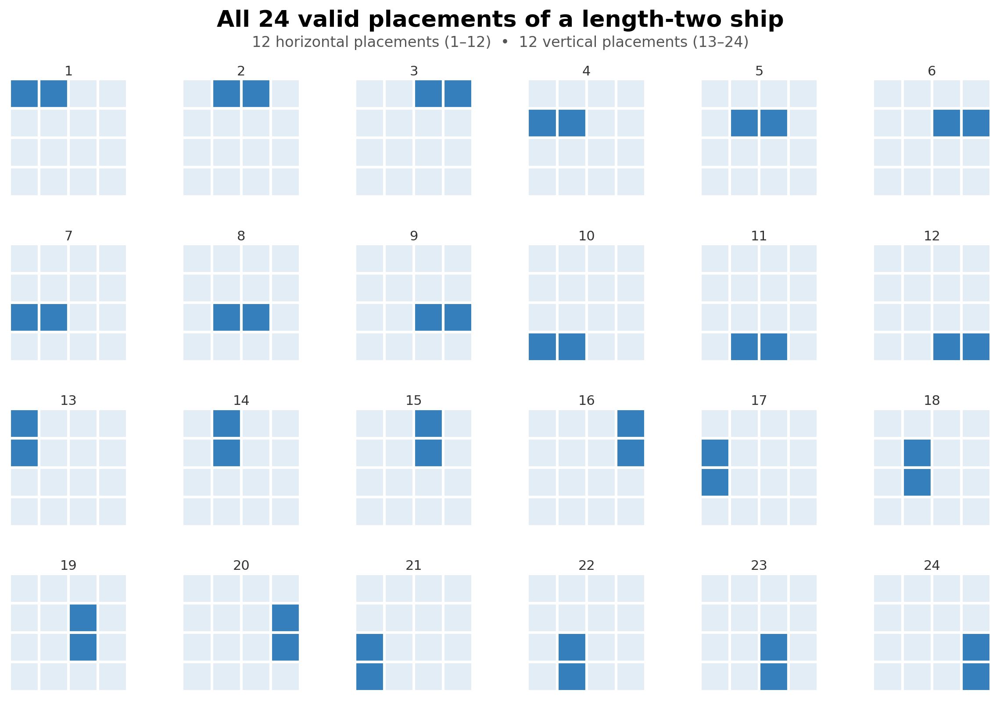

## Introduction

As I began learning about the Kalman filter and Bayesian estimation, I couldn't help but think about the game of Battleship. In Battleship, every hit or miss provides new information about the possible locations of hidden ships. Even when we miss, we learn something. This resembles the fundamental idea behind Bayesian estimation: combining what we previously believed with new observations to improve our understanding of an unknown state.

But traditional Battleship assumes ships remain stationary. **What happens when the ships can move?**

Imagine tracking a ship that can travel straight, turn left, or turn right. We don't know its exact location, and we don't know which maneuver it is performing. Instead, we receive imperfect observations and must continually update our predictions.

This creates two interconnected estimation problems:

1. **State estimation:** Where is the ship currently located?
2. **Motion-model estimation:** Which maneuver is the ship most likely performing?

This blog post explores how Bayesian state estimation can address both problems simultaneously.

We will model a ship moving across a discrete grid, with several predefined motion models governing its behavior. The ship can transition between these models according to a Markov chain, while noisy or incomplete measurements provide information about its location.

Using recursive Bayesian updates, we will estimate the probability distribution over the ship's possible locations and motion modes. We will then use Monte Carlo simulations to investigate how accurately the estimator tracks the ship, how quickly it recognizes changes in maneuver, and how measurement uncertainty affects its performance.

### Research Questions

This blog investigates three central questions:

1. **Prediction:** How can we predict a ship's next position using its current state and possible motion models?
2. **Estimation:** How can Bayesian updates combine predictions with uncertain measurements to estimate both position and maneuver?
3. **Performance:** Does accounting for multiple motion models improve tracking accuracy compared with assuming a single motion model?

### Hypothesis

A Bayesian estimator that accounts for multiple possible motion models will track a maneuvering ship more accurately than an estimator assuming a single motion model, particularly when the ship changes direction.

This hypothesis will be evaluated through numerical experiments rather than assumed to be true.

## 1. From Battleship to Dynamic State Estimation

In traditional Battleship, ships remain stationary throughout the game. Although their locations are unknown, their positions do not change. As players make guesses and receive information about hits and misses, they can gradually narrow down the possible locations of their opponent's ships.

Interestingly, even if we assume that every valid ship placement is equally likely, **that does not necessarily mean every grid cell has an equal probability of containing a ship.**

Consider the following example.


### Why Some Cells Are More Likely Than Others

Suppose we have a 4×4 grid containing a single ship that occupies two consecutive cells, either horizontally or vertically. There are 24 possible placements of this ship, and if we have no prior information favoring one placement over another, each placement has a probability of

$$
P(\text{placement})=\frac{1}{24}\approx 4.17\%.
$$

However, some grid cells belong to more possible ship placements than others.

<style>
.heatmap-grid {
  --cell-size: 62px;
  display: grid;
  grid-template-columns: repeat(4, var(--cell-size));
  gap: 6px;
  width: max-content;
  max-width: 100%;
  margin: 0 auto;
}

.heatmap-cell {
  width: var(--cell-size);
  aspect-ratio: 1 / 1;
  box-sizing: border-box;
  display: flex;
  align-items: center;
  justify-content: center;
  font-size: 0.95rem;
  font-weight: 500;
  border-radius: 7px;
  color: #111;
}

.p1 { background-color: #dbe8f4; }
.p2 { background-color: #bdd5ea; }
.p3 { background-color: #96bddc; }
.p4 { background-color: #6fa3cf; }

.battleship-figure {
  text-align: center;
}

.battleship-figure img {
  width: 100%;
  height: auto;
}

.battleship-caption {
  text-align: center;
  font-size: 0.85rem;
  color: #666;
  margin-top: 12px;
}
</style>

::: {.columns}

::: {.column width="55%"}

<div class="battleship-figure">

{width="100%"}

</div>

:::

::: {.column width="45%"}

<div class="heatmap-grid">
  <div class="heatmap-cell p1">8.3%</div>
  <div class="heatmap-cell p2">12.5%</div>
  <div class="heatmap-cell p2">12.5%</div>
  <div class="heatmap-cell p1">8.3%</div>

  <div class="heatmap-cell p2">12.5%</div>
  <div class="heatmap-cell p4">16.7%</div>
  <div class="heatmap-cell p4">16.7%</div>
  <div class="heatmap-cell p2">12.5%</div>

  <div class="heatmap-cell p2">12.5%</div>
  <div class="heatmap-cell p4">16.7%</div>
  <div class="heatmap-cell p4">16.7%</div>
  <div class="heatmap-cell p2">12.5%</div>

  <div class="heatmap-cell p1">8.3%</div>
  <div class="heatmap-cell p2">12.5%</div>
  <div class="heatmap-cell p2">12.5%</div>
  <div class="heatmap-cell p1">8.3%</div>
</div>

:::

:::

<div class="battleship-caption">
Left: All 24 possible placements of a length-two ship.
Right: Probability that each grid cell contains part of the ship.
</div>

A corner cell, for example, can only be occupied by two possible ship placements, while one of the four central cells can be occupied by four. Therefore, even though every placement is equally likely, the probability that a particular cell contains part of the ship is not uniform.

For a corner cell,

$$
P(\text{corner occupied})=\frac{2}{24}\approx 8.33\%.
$$

For a cell in the center of the board,

$$
P(\text{center occupied})=\frac{4}{24}\approx 16.67\%.
$$

This illustrates an important distinction: **the probability of a complete ship configuration is not the same as the probability that an individual cell is occupied.**

Now suppose we fire at a cell and miss. We can eliminate every possible ship placement that includes that cell. The remaining placements become our new set of possibilities, and their probabilities are updated accordingly.

This is an example of Bayesian inference. We begin with a prior belief about the ship's location, incorporate new information from our observation, and obtain an updated belief called the posterior.

### From Static Inference to Dynamic Estimation

So far, we have assumed that the ship cannot move. Once a placement is ruled out, it stays ruled out because the ship remains stationary.

But what happens if the ship is allowed to move?

Imagine that after every turn, the ship can travel forward, turn left, or turn right. A cell that was empty during the previous turn might contain the ship during the next turn. Suddenly, we can no longer estimate its position using only the history of hits and misses.

We must also account for **how the ship might move between observations.**

This changes the problem from static inference to dynamic state estimation.

In static inference, we are estimating an unknown quantity that remains constant. In dynamic state estimation, the quantity we are estimating evolves over time.

A dynamic estimator must repeatedly perform two operations:

1. **Prediction:** Use a model of the ship's motion to predict where it might move next.
2. **Measurement update:** Incorporate a new observation to correct our prediction and update the probabilities of the possible states.

This prediction-and-update process is the foundation of recursive Bayesian filtering.

### Discrete and Continuous States

Before developing our motion model, it is useful to distinguish between discrete time, discrete states, and continuous states.

A **discrete-time system** updates at specific time intervals rather than continuously. For example, our ship might move once every five seconds, with its state updated at each time step.

A **discrete-state system** has a finite or countable set of possible states. In Battleship, a ship might occupy cell A1, B2, or C3, but it cannot occupy a position halfway between cells.

By contrast, a **continuous-state system** allows quantities such as position and velocity to take any real value within a specified range. Real ships move through continuous physical space, but we can simplify their motion by restricting them to a grid.

These distinctions matter because the structure of the state space influences which estimation methods are appropriate. A conventional Kalman filter is designed for linear systems with Gaussian uncertainty, whereas a finite-state Bayesian filter can directly represent probabilities over individual grid cells and motion modes.

### Our Moving Battleship Model

For this project, we will consider a single ship moving across a finite, two-dimensional grid.

To keep the problem manageable, we will make several simplifying assumptions:

- The ship occupies one grid cell at each time step.
- The ship has a heading corresponding to one of four directions: north, east, south, or west.
- At each time step, the ship follows one of three possible motion modes: straight, left turn, or right turn.
- The motion mode can change over time according to predefined transition probabilities.
- We receive imperfect observations of the ship's location, meaning that a measurement does not always identify the correct cell.

The ship's state will therefore contain three pieces of information: its **position, heading, and motion mode**.

Our objective is to estimate all three from a sequence of noisy observations.

This raises an interesting question: *If we observe a ship moving across a grid, can we determine not only where it is, but also which maneuver it is performing?*

In the following sections, we will develop a probabilistic motion model and use Bayesian filtering to investigate that question.

## 2. Modeling a Moving Ship

Before we can estimate where a ship is going, we first need a model that describes how it can move. In traditional Battleship, this isn't necessary because the ships remain stationary. But once we allow the ship to move, its future position depends on its current position, the direction it's facing, and the maneuver it's performing.

Rather than modeling a ship moving continuously through the ocean, we will simplify the problem by representing its motion on a finite grid.

### Defining the Ship's State

Consider a 10×10 grid containing a single ship that occupies one cell at a time. At each time step, the ship has a position, a heading, and a motion mode.

We can represent its complete state as

$$
s_k=(x_k,y_k,h_k,m_k),
$$

where:

- $x_k$ is the ship's horizontal grid coordinate.
- $y_k$ is the ship's vertical grid coordinate.
- $h_k$ is its heading (north, east, south, or west).
- $m_k$ is its motion mode (straight, left turn, or right turn).
- $k$ is the current time step.

For example, the state

$$
s_k=(4,6,\text{north},\text{straight})
$$

means the ship is currently located at grid cell $(4,6)$, facing north, and following the straight-motion model.

Although we can describe the ship using a state, we do not necessarily know its true state. Our estimator will maintain a probability distribution over the possible states and update that distribution whenever a new measurement becomes available.

### Three Possible Motion Models

We will begin with three possible motion models:

1. **Straight:** The ship maintains its current heading and moves forward.
2. **Left turn:** The ship turns 90 degrees to the left and moves forward in its new direction.
3. **Right turn:** The ship turns 90 degrees to the right and moves forward in its new direction.

For simplicity, we assume the ship moves exactly one grid cell per time step. We also define turns to occur before the ship moves into its next cell.

For example, if the ship is facing north, its possible movements are:

| Motion model | New heading | Position change |
|---|---|---|
| Straight | North | $(0,+1)$ |
| Left turn | West | $(-1,0)$ |
| Right turn | East | $(+1,0)$ |

The same rules apply when the ship faces other directions, with the position changes rotated accordingly.

### Writing the Motion Model Mathematically

We can describe the ship's movement using a discrete-time state transition.

Let the heading be represented by an integer:

$$
h_k \in \{0,1,2,3\},
$$

where $0$ represents north, $1$ east, $2$ south, and $3$ west.

Next, assign a turn value to each motion mode:

$$
u(m_k)=
\begin{cases}
0 & \text{straight},\\
-1 & \text{left turn},\\
+1 & \text{right turn}.
\end{cases}
$$

The ship's new heading is then

$$
h_{k+1}=(h_k+u(m_k))\bmod 4.
$$

The modulo operation ensures that the heading always remains one of the four possible directions.

Once we know the new heading, we can calculate the ship's next position:

$$
\begin{bmatrix}
x_{k+1}\\
y_{k+1}
\end{bmatrix}
=
\begin{bmatrix}
x_k\\
y_k
\end{bmatrix}
+
d(h_{k+1}),
$$

where the heading-dependent displacement is

$$
d(h)=
\begin{cases}
(0,1)^T & h=0,\\
(1,0)^T & h=1,\\
(0,-1)^T & h=2,\\
(-1,0)^T & h=3.
\end{cases}
$$

These equations describe how the ship moves from one state to the next when its motion mode is known.

### Introducing Uncertainty

So far, our motion models are deterministic. If we know the ship's position, heading, and motion mode, we can calculate exactly where it will move next.

However, our estimator does not necessarily know which motion mode the ship is following.

For example, suppose the ship is facing north at cell $(4,4)$. If it continues straight, it will move to $(4,5)$. If it turns left, it will move to $(3,4)$. If it turns right, it will move to $(5,4)$.

Rather than predicting one location with certainty, we can assign probabilities to these different possibilities.

We will model the motion mode as a random variable that can change over time. Its transition probabilities will tell us how likely the ship is to continue following its current motion model or switch to another.

For now, we assume that once a motion mode is selected, the corresponding movement occurs exactly as defined. Our uncertainty comes from not knowing the ship's true state and from the possibility that its motion mode changes. Additional randomness in the movement itself could be introduced later.

### Handling Grid Boundaries

Because the ship moves on a finite grid, we also need to decide what happens when a maneuver would take it outside the board.

For this project, we will assume that transitions leading outside the grid are not allowed. The ship must choose among the motion modes that keep it within the grid.

This introduces an important detail: near the edge of the board, the available motion modes may be more restricted than they are in the center.

We will account for these restrictions when defining the state transition probabilities.

### From Motion Models to Probabilities

We now have a mathematical description of how a ship can move under three different motion models.

But one question remains unanswered: **How likely is the ship to continue straight, turn left, or turn right?**

The ship might tend to continue its current maneuver, rather than randomly changing direction at every time step.

To model this behavior, we will use a Markov chain. This allows us to assign probabilities to the transitions between motion modes and predict how the ship's state distribution evolves over time.

In the next section, we will develop this transition model and begin connecting the ship's dynamics to Bayesian estimation.


## 3. Markov Chains and Motion-Model Transitions

In the previous section, we defined three possible motion models that describe how our ship moves across the board: straight, left turn, and right turn. However, a maneuvering ship is unlikely to follow the same motion model indefinitely. It may travel straight for several time steps, initiate a turn, and then resume traveling straight.

How can we mathematically describe this behavior?

### 3.1 The Markov Property

A Markov chain describes a stochastic process that transitions between a finite set of states according to a set of probabilities.

The defining characteristic of a Markov chain is the **Markov property**, which states that the probability of transitioning to the next state depends only on the current state, rather than the entire history of previous states.

Let $m_k$ represent the ship's motion mode at time step $k$. The Markov property can be expressed mathematically as

$$
P(m_{k+1} \mid m_k, m_{k-1}, \ldots, m_0)
=
P(m_{k+1} \mid m_k).
$$

In other words, if we know that the ship is currently turning left, we do not need to know every maneuver it has previously performed to determine the probability of its next motion mode.

This assumption simplifies our problem significantly. Rather than keeping track of the entire maneuver history of the ship, we only need to consider its current motion mode when predicting its next motion mode.

### 3.2 The Transition Probability Matrix

Recall that our ship can operate under one of three motion modes:

- $S$: Straight
- $L$: Left turn
- $R$: Right turn

We can describe the probability of transitioning between these modes using a **transition probability matrix**.

Let

$$
T_{ij} = P(m_{k+1}=j \mid m_k=i),
$$

where $i$ represents the current motion mode and $j$ represents the next motion mode.

For this simulation, suppose we define the following transition matrix:

$$
T =
\begin{bmatrix}
0.80 & 0.10 & 0.10 \\
0.20 & 0.75 & 0.05 \\
0.20 & 0.05 & 0.75
\end{bmatrix}.
$$

The rows represent the current motion mode, while the columns represent the next motion mode.

| Current Mode | Straight ($S$) | Left ($L$) | Right ($R$) |
|:-------------|:--------------:|:----------:|:-----------:|
| Straight ($S$) | 0.80 | 0.10 | 0.10 |
| Left ($L$) | 0.20 | 0.75 | 0.05 |
| Right ($R$) | 0.20 | 0.05 | 0.75 |

For example, if the ship is currently traveling straight, there is:

- An 80% probability that it will continue traveling straight.
- A 10% probability that it will begin turning left.
- A 10% probability that it will begin turning right.

Since the ship must operate under exactly one motion mode at the next time step, each row of the transition matrix must sum to one:

$$
\sum_{j \in \{S,L,R\}} T_{ij} = 1.
$$

Notice that the transition matrix does not determine exactly which maneuver the ship will perform next. Instead, it describes the probability distribution from which the next maneuver is selected.

### 3.3 Motion-Mode Persistence

One important feature of our transition matrix is that the diagonal entries are significantly larger than the off-diagonal entries.

This means that the ship is more likely to remain in its current motion mode than to transition to a different one.

This assumption is motivated by the observation that physical systems often exhibit temporal correlation in their motion. A maneuvering vehicle typically does not switch randomly between unrelated maneuvers at every time step.

For example, suppose the ship is currently traveling straight. The probability that it continues traveling straight for the next three consecutive time steps is

$$
P(S \rightarrow S \rightarrow S \rightarrow S)
=
(0.80)^3
=
0.512.
$$

Therefore, there is a 51.2% probability that the ship continues traveling straight without changing its motion mode over the next three time steps.

More generally, the probability of remaining in motion mode $i$ for the next $n$ transitions is

$$
P(\text{no mode change over } n \text{ transitions})
=
(T_{ii})^n.
$$

By adjusting the diagonal entries of the transition matrix, we can control how frequently the ship changes its motion mode.

A transition matrix with large diagonal entries produces persistent maneuvers, while a transition matrix with smaller diagonal entries produces more frequent changes in motion.

### 3.4 Predicting the Next Motion Mode

Suppose we are observing the ship and are uncertain about which motion mode it is currently following.

We can represent our belief about its current motion mode using a probability vector:

$$
\boldsymbol{\mu}_k =
\begin{bmatrix}
P(m_k=S) \\
P(m_k=L) \\
P(m_k=R)
\end{bmatrix}.
$$

For example, suppose we initially know that the ship is traveling straight. Our initial probability vector is

$$
\boldsymbol{\mu}_0 =
\begin{bmatrix}
1 \\
0 \\
0
\end{bmatrix}.
$$

Using the transition matrix, we can predict the probability distribution of the ship's motion mode at the next time step:

$$
\boldsymbol{\mu}_{k+1}
=
T^T\boldsymbol{\mu}_k.
$$

The transpose is required because our transition matrix stores the current modes along its rows, while our probability distribution is represented as a column vector.

After one time step, our predicted probability distribution becomes

$$
\boldsymbol{\mu}_1 =
\begin{bmatrix}
0.80 & 0.20 & 0.20 \\
0.10 & 0.75 & 0.05 \\
0.10 & 0.05 & 0.75
\end{bmatrix}
\begin{bmatrix}
1 \\
0 \\
0
\end{bmatrix}
=
\begin{bmatrix}
0.80 \\
0.10 \\
0.10
\end{bmatrix}.
$$

After another time step,

$$
\boldsymbol{\mu}_2
=
T^T\boldsymbol{\mu}_1
=
\begin{bmatrix}
0.68 \\
0.16 \\
0.16
\end{bmatrix}.
$$

Without receiving any additional measurements, we become increasingly uncertain about which motion mode the ship is following.

In general, we can predict the motion-mode probability distribution $n$ time steps into the future using

$$
\boldsymbol{\mu}_{k+n}
=
(T^T)^n\boldsymbol{\mu}_k.
$$

### 3.5 Effect on Predicted Ship Trajectories

The transition probabilities directly influence the possible trajectories of the ship.

Suppose the ship is initially traveling north under the straight motion model. At the next time step, the ship has three possible outcomes:

- Continue north with probability 0.80.
- Turn left and travel west with probability 0.10.
- Turn right and travel east with probability 0.10.

At the following time step, each of these possible trajectories branches into three additional possibilities.

The probability of a particular sequence of motion modes can be calculated by multiplying the corresponding transition probabilities.

For example, the probability that the ship continues straight, turns left, and then continues straight is

$$
\begin{aligned}
P(S,S,L,S \mid m_0=S)
&= P(S \mid S)P(L \mid S)P(S \mid L) \\
&= (0.80)(0.10)(0.20) \\
&= 0.016.
\end{aligned}
$$

Thus, this particular sequence of future maneuvers has a probability of 1.6%.

As we predict further into the future, the number of possible motion-mode sequences grows exponentially. For three possible motion modes and a prediction horizon of $n$ time steps, there are

$$
3^n
$$

possible mode sequences before accounting for restrictions imposed by the board boundaries.

Although some sequences may result in the same final ship state, their individual probabilities must still be accounted for when constructing the predicted state distribution.

This illustrates one of the fundamental challenges of tracking a maneuvering target: uncertainty in its future motion leads to uncertainty in its future position and heading.

### 3.6 The True Motion Mode vs. the Estimated Motion Mode

An important distinction must be made between the actual motion of the ship and our knowledge of that motion.

At any given time step, the ship operates under exactly one motion mode:

$$
m_k \in \{S,L,R\}.
$$

However, the estimator does not have direct access to this information. Instead, it maintains a probability distribution over the possible motion modes.

For example, the ship may actually be turning left while the estimator maintains the following belief:

$$
\boldsymbol{\mu}_k =
\begin{bmatrix}
0.60 \\
0.30 \\
0.10
\end{bmatrix}.
$$

In this case, the estimator believes that traveling straight is the most likely motion mode, even though the ship is actually turning left.

This does not necessarily mean that the estimator is functioning incorrectly. Its belief reflects the information available to it at that particular time.

The transition matrix allows the estimator to predict how these probabilities evolve, while incoming measurements provide new information that can be used to correct these predictions.

Our objective is therefore not simply to estimate the position of the ship, but to estimate a joint probability distribution over its position, heading, and motion mode:

$$
P(x_k,y_k,h_k,m_k \mid z_{1:k}),
$$

where $z_{1:k}$ represents the history of measurements received through time step $k$.

This combination of probabilistic motion prediction and measurement-based correction forms the foundation of the Bayesian filter, which we will develop in the next section.


## 4. Bayesian Filtering: Predicting and Updating the Ship's State

We now have a model that describes how our ship moves and a Markov chain that describes how it transitions between motion modes. However, knowing how the ship *might* move does not necessarily tell us where it actually is.

Suppose we have a radar system that provides an estimate of the ship's location at every time step. Unfortunately, these measurements are imperfect. The radar might indicate that the ship is in one cell when it is actually in a neighboring cell.

Should we trust our motion model or the radar measurement?

Rather than choosing one over the other, Bayesian filtering allows us to combine both sources of information according to their probabilities.

### 4.1 Revisiting Bayes' Theorem

Recall our original Battleship example, where we updated the probabilities of possible ship placements after receiving information about a hit or miss.

This process is governed by Bayes' theorem:

$$
P(A \mid B)
=
\frac{P(B \mid A)P(A)}{P(B)}.
$$

In the context of state estimation, we can rewrite Bayes' theorem as

$$
P(s \mid z)
=
\frac{P(z \mid s)P(s)}{P(z)},
$$

where $s$ represents the ship's state and $z$ represents an observation.

Each term has a specific interpretation:

- **Prior, $P(s)$:** What we believe about the ship's state before receiving a measurement.
- **Likelihood, $P(z \mid s)$:** How likely we are to receive the measurement if the ship is actually in state $s$.
- **Evidence, $P(z)$:** The overall probability of receiving the measurement across all possible states.
- **Posterior, $P(s \mid z)$:** Our updated belief about the ship's state after incorporating the measurement.

The fundamental idea is that a measurement does not necessarily tell us which state is correct. Instead, it provides evidence that makes certain states more or less probable.

Unlike traditional Battleship, however, our ship moves between observations. This means that before applying Bayes' theorem, we must first predict how our previous probability distribution evolves through time.

### 4.2 Representing Our Belief About the Ship

Recall from Section 2 that the complete state of our ship is

$$
s_k=(x_k,y_k,h_k,m_k).
$$

Rather than maintaining a single estimate of this state, our Bayesian estimator maintains a probability distribution over all possible combinations of position, heading, and motion mode.

We can represent this distribution as

$$
b_k(s_k)
=
P(s_k \mid z_{1:k}),
$$

where

$$
z_{1:k}=\{z_1,z_2,\ldots,z_k\}
$$

represents the collection of measurements received through time step $k$.

We will refer to $b_k$ as the estimator's **belief distribution**.

For our 10×10 grid, we have:

- 100 possible locations.
- 4 possible headings.
- 3 possible motion modes.

Therefore, the total number of candidate states before accounting for any additional restrictions is

$$
N_s=100(4)(3)=1200.
$$

The estimator assigns a probability to each of these states, such that

$$
\sum_{s_k \in \mathcal{S}} b_k(s_k)=1,
$$

where $\mathcal{S}$ represents the set of all possible states.

For example, the two states

$$
s^{(1)}=(4,6,\text{north},S)
$$

and

$$
s^{(2)}=(4,6,\text{west},L)
$$

represent the same ship location but different headings and motion modes.

Although a radar measurement might provide evidence that the ship is located at $(4,6)$, it does not necessarily tell us which of these two states is correct.

Maintaining a joint probability distribution allows us to represent these different possibilities simultaneously.

### 4.3 The Prediction Step

Suppose we have already estimated the ship's state at time step $k-1$ and have obtained the belief distribution

$$
b_{k-1}(s_{k-1})
=
P(s_{k-1}\mid z_{1:k-1}).
$$

Before receiving our next measurement, we want to predict what the ship's state might be at time step $k$.

To do this, we use the motion models developed in Section 2 and the transition probabilities developed in Section 3.

Let

$$
P(s_k\mid s_{k-1})
$$

represent the probability of transitioning from state $s_{k-1}$ to state $s_k$.

For the following formulation, we will use the convention that the ship first selects its next motion mode, $m_k$, and then performs the corresponding maneuver to arrive at state $s_k$. This follows the transition-then-move interpretation introduced in Section 3.

Away from the grid boundaries, the state transition probability can be expressed as

$$
P(s_k\mid s_{k-1})
=
\begin{cases}
T_{m_{k-1},m_k}, & \text{if the motion model produces } s_k,\\
0, & \text{otherwise}.
\end{cases}
$$

This means that once a new motion mode is selected, the resulting position and heading are determined by the motion equations.

For example, suppose the ship is currently in the state

$$
s_{k-1}=(4,4,\text{north},S).
$$

Using our transition matrix, the possible next states are

| Possible next state | Transition probability |
|---|---:|
| $(4,5,\text{north},S)$ | 0.80 |
| $(3,4,\text{west},L)$ | 0.10 |
| $(5,4,\text{east},R)$ | 0.10 |

Every other next state has a transition probability of zero when starting from this particular state.

As discussed in Section 2, transitions that would move the ship outside the grid are not allowed. Near a boundary, we therefore assign zero probability to invalid maneuvers and redistribute their probability among the valid maneuvers in proportion to their original transition probabilities.

To predict the complete state distribution, we must consider every possible previous state and the probability that it transitions into each possible next state.

This gives us the **Bayesian prediction equation**:

$$
\boxed{
\bar{b}_k(s_k)
=
\sum_{s_{k-1}\in\mathcal{S}}
P(s_k\mid s_{k-1})
b_{k-1}(s_{k-1})
}
$$

where

$$
\bar{b}_k(s_k)
=
P(s_k\mid z_{1:k-1})
$$

represents our predicted belief before receiving the measurement at time step $k$.

Notice that multiple previous states may transition into the same next state. When this happens, their probability contributions are added together.

The prediction step essentially redistributes probability throughout the state space according to the ship's possible movements.

### 4.4 Modeling Imperfect Measurements

So far, we have only considered uncertainty associated with the ship's motion. We now need to introduce uncertainty associated with our observations.

Suppose that at every time step, a radar-like sensor provides a measurement of the ship's position:

$$
z_k=(x_k^{\text{meas}},y_k^{\text{meas}}).
$$

We assume that the sensor does not directly measure the ship's heading or motion mode.

To keep our measurement model simple, suppose that when the ship is away from the grid boundaries:

- There is a 60% probability that the sensor reports the correct cell.
- There is a 10% probability that it reports the cell immediately north of the ship.
- There is a 10% probability that it reports the cell immediately south of the ship.
- There is a 10% probability that it reports the cell immediately east of the ship.
- There is a 10% probability that it reports the cell immediately west of the ship.

These probabilities are illustrative modeling assumptions rather than characteristics of an actual radar system.

<style>
.measurement-grid {
  display: grid;
  grid-template-columns: repeat(3, 70px);
  gap: 5px;
  width: max-content;
  margin: 20px auto;
}

.measurement-cell {
  width: 70px;
  height: 70px;
  display: flex;
  align-items: center;
  justify-content: center;
  flex-direction: column;
  border-radius: 7px;
  font-size: 0.95rem;
  color: #111;
  background-color: #f0f0f0;
}

.measurement-neighbor {
  background-color: #bdd5ea;
}

.measurement-center {
  background-color: #6fa3cf;
  font-weight: 600;
}
</style>

<div class="measurement-grid">
  <div class="measurement-cell">0%</div>
  <div class="measurement-cell measurement-neighbor">10%</div>
  <div class="measurement-cell">0%</div>

  <div class="measurement-cell measurement-neighbor">10%</div>
  <div class="measurement-cell measurement-center">
    60%
    <small>True cell</small>
  </div>
  <div class="measurement-cell measurement-neighbor">10%</div>

  <div class="measurement-cell">0%</div>
  <div class="measurement-cell measurement-neighbor">10%</div>
  <div class="measurement-cell">0%</div>
</div>

<div class="battleship-caption">
Probability distribution of possible sensor measurements given the ship's true location.
</div>

Mathematically, we can describe this measurement model using the likelihood function

$$
P(z_k\mid s_k)
=
\begin{cases}
0.60, & d=0,\\
0.10, & d=1,\\
0, & \text{otherwise},
\end{cases}
$$

for a ship located away from the grid boundaries, where

$$
d=
|x_k^{\text{meas}}-x_k|
+
|y_k^{\text{meas}}-y_k|
$$

is the Manhattan distance between the measured location and the ship's true location.

The Manhattan distance measures the number of horizontal and vertical grid movements required to travel between two cells.

Near the boundaries, we will exclude measurements that fall outside the grid and normalize the remaining measurement probabilities.

An important feature of this measurement model is that the likelihood depends only on the ship's position:

$$
P(z_k\mid x_k,y_k,h_k,m_k)
=
P(z_k\mid x_k,y_k).
$$

The sensor does not directly provide information about the ship's heading or motion mode.

However, as we will see shortly, measurements of position can still provide indirect information about both.

### 4.5 The Measurement Update

After completing the prediction step, we receive a new measurement $z_k$.

We now want to determine how this measurement changes our predicted probability distribution.

Using Bayes' theorem, we obtain

$$
P(s_k\mid z_{1:k})
=
\frac{
P(z_k\mid s_k)
P(s_k\mid z_{1:k-1})
}{
P(z_k\mid z_{1:k-1})
}.
$$

Using our belief notation, this becomes

$$
b_k(s_k)
=
\frac{
P(z_k\mid s_k)\bar{b}_k(s_k)
}{
P(z_k\mid z_{1:k-1})
}.
$$

The numerator combines two sources of information:

1. How likely the state was according to our motion prediction.
2. How consistent the state is with the new measurement.

A state that was already highly probable and is consistent with the measurement will generally receive a higher posterior probability.

Conversely, a state that is inconsistent with the measurement will receive a lower posterior probability, even if it was initially favored by the motion model.

### 4.6 Normalizing the Probability Distribution

Multiplying the predicted probability of each state by its measurement likelihood does not necessarily produce a distribution that sums to one.

We must therefore normalize the resulting probabilities.

First, calculate the unnormalized probability of each state:

$$
\tilde{b}_k(s_k)
=
P(z_k\mid s_k)\bar{b}_k(s_k).
$$

Next, calculate the normalization constant:

$$
\eta_k
=
\sum_{s_k\in\mathcal{S}}
\tilde{b}_k(s_k).
$$

This constant is the evidence term in Bayes' theorem:

$$
\eta_k=P(z_k\mid z_{1:k-1}).
$$

Finally, divide each unnormalized probability by the normalization constant to obtain the posterior distribution:

$$
\boxed{
b_k(s_k)
=
\frac{
P(z_k\mid s_k)\bar{b}_k(s_k)
}{
\displaystyle
\sum_{s'_k\in\mathcal{S}}
P(z_k\mid s'_k)\bar{b}_k(s'_k)
}
}
$$

The resulting probabilities sum to one:

$$
\sum_{s_k\in\mathcal{S}} b_k(s_k)=1.
$$

This assumes that the normalization constant is greater than zero. If it is zero, the measurement is impossible under every state currently considered possible by the estimator. Such a situation would indicate that our motion or measurement assumptions need to be reconsidered.

We now have an updated belief about the ship's location, heading, and motion mode.

### 4.7 A Numerical Example

Let's work through a complete prediction and measurement update.

Suppose we initially know that the ship is located at $(4,4)$, facing north, and traveling straight.

Its initial state is

$$
s_0=(4,4,\text{north},S).
$$

Since we know its initial state exactly, we assign this state a probability of one and every other state a probability of zero.

**Step 1: Prediction**

Using our Markov transition matrix, we obtain three possible next states:

$$
\begin{aligned}
s^{(1)}&=(4,5,\text{north},S),\\
s^{(2)}&=(3,4,\text{west},L),\\
s^{(3)}&=(5,4,\text{east},R).
\end{aligned}
$$

Their predicted probabilities are

$$
\begin{aligned}
\bar{b}_1(s^{(1)})&=0.80,\\
\bar{b}_1(s^{(2)})&=0.10,\\
\bar{b}_1(s^{(3)})&=0.10.
\end{aligned}
$$

At this point, we believe the ship is most likely traveling north.

**Step 2: Receive a measurement**

Suppose our radar reports that the ship is located at

$$
z_1=(3,5).
$$

Interestingly, this measurement does not correspond exactly to any of our three predicted locations.

However, it is immediately adjacent to two of them:

- The predicted straight-motion location, $(4,5)$.
- The predicted left-turn location, $(3,4)$.

The predicted right-turn location, $(5,4)$, is three grid movements away from the reported measurement.

Using our measurement model, the likelihoods are therefore

$$
\begin{aligned}
P(z_1\mid s^{(1)})&=0.10,\\
P(z_1\mid s^{(2)})&=0.10,\\
P(z_1\mid s^{(3)})&=0.
\end{aligned}
$$

**Step 3: Calculate the unnormalized probabilities**

We multiply each predicted probability by its corresponding measurement likelihood:

| Motion mode | Predicted probability | Likelihood | Unnormalized probability |
|---|---:|---:|---:|
| Straight | 0.80 | 0.10 | 0.080 |
| Left turn | 0.10 | 0.10 | 0.010 |
| Right turn | 0.10 | 0.00 | 0.000 |

The normalization constant is

$$
\eta_1=0.080+0.010+0.000=0.090.
$$

**Step 4: Calculate the posterior probabilities**

Dividing each unnormalized probability by the normalization constant gives

$$
b_1(s^{(1)})
=
\frac{0.080}{0.090}
\approx 0.8889,
$$

$$
b_1(s^{(2)})
=
\frac{0.010}{0.090}
\approx 0.1111,
$$

and

$$
b_1(s^{(3)})
=
\frac{0}{0.090}
=
0.
$$

Our updated belief is therefore

| Motion mode | Before measurement | After measurement |
|---|---:|---:|
| Straight | 80% | 88.89% |
| Left turn | 10% | 11.11% |
| Right turn | 10% | 0% |

<style>
.bayes-comparison {
  max-width: 550px;
  margin: 25px auto;
}

.bayes-mode {
  margin-bottom: 18px;
}

.bayes-mode-label {
  font-weight: 600;
  margin-bottom: 5px;
}

.bayes-bar-row {
  display: flex;
  align-items: center;
  gap: 10px;
  margin: 5px 0;
}

.bayes-bar-label {
  width: 65px;
  flex-shrink: 0;
  font-size: 0.8rem;
}

.bayes-bar-track {
  background-color: rgba(128, 128, 128, 0.12);
  border-radius: 5px;
  flex: 1;
  height: 27px;
  overflow: hidden;
}

.bayes-bar {
  height: 100%;
  border-radius: 5px;
}

.bayes-prior {
  background-color: #a6c8e0;
}

.bayes-posterior {
  background-color: #397cb5;
}

.bayes-value {
  width: 55px;
  text-align: right;
  font-size: 0.85rem;
}
</style>

<div class="bayes-comparison">

  <div class="bayes-mode">
    <div class="bayes-mode-label">Straight</div>
    <div class="bayes-bar-row">
      <div class="bayes-bar-label">Before</div>
      <div class="bayes-bar-track">
        <div class="bayes-bar bayes-prior" style="width:80%"></div>
      </div>
      <div class="bayes-value">80%</div>
    </div>
    <div class="bayes-bar-row">
      <div class="bayes-bar-label">After</div>
      <div class="bayes-bar-track">
        <div class="bayes-bar bayes-posterior" style="width:88.89%"></div>
      </div>
      <div class="bayes-value">88.89%</div>
    </div>
  </div>

  <div class="bayes-mode">
    <div class="bayes-mode-label">Left Turn</div>
    <div class="bayes-bar-row">
      <div class="bayes-bar-label">Before</div>
      <div class="bayes-bar-track">
        <div class="bayes-bar bayes-prior" style="width:10%"></div>
      </div>
      <div class="bayes-value">10%</div>
    </div>
    <div class="bayes-bar-row">
      <div class="bayes-bar-label">After</div>
      <div class="bayes-bar-track">
        <div class="bayes-bar bayes-posterior" style="width:11.11%"></div>
      </div>
      <div class="bayes-value">11.11%</div>
    </div>
  </div>

  <div class="bayes-mode">
    <div class="bayes-mode-label">Right Turn</div>
    <div class="bayes-bar-row">
      <div class="bayes-bar-label">Before</div>
      <div class="bayes-bar-track">
        <div class="bayes-bar bayes-prior" style="width:10%"></div>
      </div>
      <div class="bayes-value">10%</div>
    </div>
    <div class="bayes-bar-row">
      <div class="bayes-bar-label">After</div>
      <div class="bayes-bar-track">
        <div class="bayes-bar bayes-posterior" style="width:0%"></div>
      </div>
      <div class="bayes-value">0%</div>
    </div>
  </div>

</div>

<div class="battleship-caption">
Comparison of predicted and posterior motion-mode probabilities after incorporating a noisy position measurement.
</div>

Notice that even though our sensor only measured position, we were able to update our belief about the ship's motion mode.

The measurement provided equally strong evidence for the straight and left-turn possibilities. However, because straight motion was more probable before receiving the measurement, it remains the most probable motion mode afterward.

Meanwhile, the right-turn possibility was eliminated because it was inconsistent with our assumed measurement model.

This illustrates one of the most important ideas in Bayesian state estimation: **we can estimate quantities that are not directly measured by exploiting their relationships with quantities that are measured.**

### 4.8 Estimating Position, Heading, and Motion Mode

Our Bayesian filter maintains a joint probability distribution over all four state variables:

$$
b_k(x,y,h,m)
=
P(x_k=x,y_k=y,h_k=h,m_k=m\mid z_{1:k}).
$$

However, we may sometimes be interested in only one component of the state.

For example, suppose we want to visualize the probability that the ship occupies a particular grid cell, regardless of its heading or motion mode.

We can obtain this probability by summing over all possible headings and motion modes:

$$
P(x_k=x,y_k=y\mid z_{1:k})
=
\sum_h\sum_m b_k(x,y,h,m).
$$

This process is called **marginalization**.

Similarly, we can obtain the probability distribution over the ship's heading:

$$
P(h_k=h\mid z_{1:k})
=
\sum_x\sum_y\sum_m b_k(x,y,h,m).
$$

We can also obtain the probability distribution over its motion mode:

$$
P(m_k=m\mid z_{1:k})
=
\sum_x\sum_y\sum_h b_k(x,y,h,m).
$$

These marginal probability distributions will be particularly useful when visualizing the results of our numerical experiments.

For example, we can use:

- A probability heatmap to visualize the ship's estimated location.
- A bar chart to visualize the probabilities of the four possible headings.
- A time-history plot to visualize the probabilities of the three motion modes as the ship maneuvers.

If we want a single estimated location rather than an entire probability distribution, one option is to select the most probable grid cell:

$$
(\hat{x}_k,\hat{y}_k)
=
\underset{(x,y)}{\arg\max}
\;
P(x_k=x,y_k=y\mid z_{1:k}).
$$

This is known as the **maximum a posteriori (MAP) estimate** of the ship's position.

Likewise, the most probable motion mode is

$$
\hat{m}_k
=
\underset{m\in\{S,L,R\}}{\arg\max}
\;
P(m_k=m\mid z_{1:k}).
$$

Alternatively, we could calculate the expected position by taking a probability-weighted average of all possible locations:

$$
\begin{bmatrix}
\hat{x}_k\\
\hat{y}_k
\end{bmatrix}
=
\sum_x\sum_y
\begin{bmatrix}
x\\
y
\end{bmatrix}
P(x_k=x,y_k=y\mid z_{1:k}).
$$

Unlike the MAP position estimate, the expected position does not necessarily correspond to an actual grid cell. However, it minimizes the expected squared position estimation error under our posterior distribution.

Although these estimates provide convenient summaries, the complete probability distribution contains additional information about the uncertainty associated with each estimate.

### 4.9 Recursive Bayesian Filtering

So far, we have performed a single prediction and measurement update. However, the ship continues moving, and additional measurements become available over time.

The posterior distribution obtained at the current time step becomes the starting point for the prediction at the next time step.

This creates a recursive process:

```{mermaid}
%%| fig-cap: "The recursive Bayesian filtering process."
flowchart TD
    A["Previous posterior"] --> B["Prediction"]
    M["Motion models and Markov transition probabilities"] --> B
    B --> C["Predicted state distribution"]
    C --> D["Measurement update"]
    Z["New sensor measurement"] --> D
    D --> E["Normalization"]
    E --> F["Updated posterior distribution"]
    F --> G["Advance to next time step"]
    G --> A
```

At every time step, the estimator performs three operations:

1. **Prediction:** Propagate the previous posterior distribution through the probabilistic motion model.

2. **Measurement update:** Multiply each predicted state probability by the likelihood of the new measurement.

3. **Normalization:** Normalize the probabilities to obtain the new posterior distribution.

Mathematically, the entire process can be summarized by two equations.

**Prediction:**

$$
\bar{b}_k(s_k)
=
\sum_{s_{k-1}\in\mathcal{S}}
P(s_k\mid s_{k-1})b_{k-1}(s_{k-1}).
$$

**Measurement update and normalization:**

$$
b_k(s_k)
=
\frac{
P(z_k\mid s_k)\bar{b}_k(s_k)
}{
\displaystyle
\sum_{s'_k\in\mathcal{S}}
P(z_k\mid s'_k)\bar{b}_k(s'_k)
}.
$$

These two equations form the foundation of our discrete Bayesian filter.

The recursive nature of the filter means that we do not need to store and reprocess every previous measurement whenever a new observation becomes available. Under the assumptions that the complete ship state satisfies the Markov property and that each measurement depends only on the current state, the previous posterior distribution summarizes the relevant information from our measurement history.

### 4.10 Why Not Use a Kalman Filter?

When I first began learning about state estimation, one question I had was when to use a Kalman filter instead of a Bayesian filter.

It turns out that the Kalman filter is itself a particular implementation of Bayesian filtering.

A conventional Kalman filter assumes that the system can be represented using linear state and measurement equations with Gaussian noise:

$$
\mathbf{x}_k
=
A\mathbf{x}_{k-1}+\mathbf{w}_k,
$$

$$
\mathbf{z}_k
=
H\mathbf{x}_k+\mathbf{v}_k,
$$

where $\mathbf{w}_k$ represents process noise and $\mathbf{v}_k$ represents measurement noise.

Under the linear-Gaussian assumptions and a Gaussian initial state distribution, the resulting probability distribution remains Gaussian. This allows the Kalman filter to represent its belief using only a mean vector and a covariance matrix.

Our moving Battleship problem, however, has several characteristics that make a conventional Kalman filter unsuitable for directly representing the complete state distribution:

- The ship's position is restricted to discrete grid cells.
- Its heading is restricted to four discrete directions.
- Its motion mode is a categorical variable.
- The motion dynamics change when the ship switches between motion modes.
- The state probability distribution may contain multiple distinct peaks.

Imagine, for example, that we believe the ship is equally likely to occupy two widely separated cells.

A single Gaussian distribution may place its highest probability density somewhere between those cells, even though our discrete belief assigns little or no probability to the intermediate locations.

<style>
.distribution-example {
  max-width: 650px;
  margin: 20px auto;
}

.distribution-example svg {
  width: 100%;
  height: auto;
}
</style>

<div class="distribution-example">
<svg viewBox="0 0 600 240" xmlns="http://www.w3.org/2000/svg">

  <line x1="45" y1="185" x2="565" y2="185" stroke="currentColor" stroke-width="1.2"/>
  <line x1="45" y1="185" x2="45" y2="25" stroke="currentColor" stroke-width="1.2"/>

  <rect x="105" y="55" width="25" height="130" rx="3" fill="#397cb5" opacity="0.8"/>
  <rect x="480" y="55" width="25" height="130" rx="3" fill="#397cb5" opacity="0.8"/>

  <path d="M45 173
           C90 164, 135 142, 180 117
           C225 92, 265 74, 305 74
           C345 74, 385 92, 430 117
           C475 142, 520 164, 565 173"
        fill="none"
        stroke="#d97706"
        stroke-width="3"/>

  <line x1="305" y1="74" x2="305" y2="185"
        stroke="#d97706"
        stroke-width="1.5"
        stroke-dasharray="5 5"/>

  <text x="117" y="45" font-size="13" text-anchor="middle" fill="#397cb5">Possible ship</text>
  <text x="117" y="30" font-size="13" text-anchor="middle" fill="#397cb5">location</text>

  <text x="492" y="45" font-size="13" text-anchor="middle" fill="#397cb5">Possible ship</text>
  <text x="492" y="30" font-size="13" text-anchor="middle" fill="#397cb5">location</text>

  <text x="305" y="60" font-size="13" text-anchor="middle" fill="#d97706">Gaussian approximation</text>

  <text x="305" y="205" font-size="12" text-anchor="middle" fill="currentColor">Mean</text>

  <text x="305" y="230" font-size="13" text-anchor="middle" fill="currentColor">Position</text>

  <text x="15" y="105" font-size="12" text-anchor="middle"
        transform="rotate(-90,15,105)" fill="currentColor">Relative probability</text>

</svg>
</div>

<div class="battleship-caption">
Conceptual comparison between a discrete probability distribution with two distinct peaks and a single Gaussian approximation. The vertical scales are illustrative.
</div>

This does not mean that Kalman filters cannot be used to track maneuvering targets. Extensions and combinations of Kalman filters can accommodate nonlinear dynamics and multiple motion models.

However, because our problem has a finite and relatively small state space, we can directly maintain and update the probability of every possible state without requiring a Gaussian approximation.

This approach is known as **exact discrete Bayesian filtering**.

### 4.11 From Exact Bayesian Filtering to Monte Carlo Methods

We now have a complete mathematical framework for estimating the position, heading, and motion mode of our moving ship.

For our 10×10 grid, maintaining a probability distribution over 1,200 possible states is computationally manageable.

But what happens as we increase the size of the grid, introduce additional motion models, or consider more possible headings?

In general, the number of possible states in our model is

$$
N_s=N_xN_yN_hN_m,
$$

where

- $N_x$ is the number of horizontal grid positions.
- $N_y$ is the number of vertical grid positions.
- $N_h$ is the number of possible headings.
- $N_m$ is the number of possible motion modes.

Consider how quickly the number of states grows as we increase the dimensions of the grid while maintaining four possible headings and three motion modes.

| Grid size | Possible states |
|---|---:|
| 10×10 | 1,200 |
| 20×20 | 4,800 |
| 50×50 | 30,000 |
| 100×100 | 120,000 |
| 1,000×1,000 | 12,000,000 |

As the state space grows, explicitly maintaining and updating every possible state can become increasingly expensive.

What if, instead of tracking every possible state, we could approximate the entire probability distribution using a collection of randomly sampled states?

This is the idea behind sampling-based estimation methods such as particle filtering, which we will explore in the next section.


## 5. Monte Carlo Methods for Dynamic State Estimation

TODO:
- Explain the difference between exact Bayesian filtering and sampling-based approximations.
- Introduce Monte Carlo sampling and its role in probabilistic estimation.
- Explain particle filtering as one possible approximation to the Bayesian state distribution.
- Describe how particles can represent candidate ship locations, headings, and motion modes.
- Explain particle prediction, measurement weighting, and resampling.
- Discuss when sampling-based approaches become useful as the state space grows.
- Clarify the distinction between ordinary Monte Carlo simulation, particle filtering, and Markov chain Monte Carlo.

## 6. Numerical Experiments

TODO:

Develop a Python simulation that generates ship trajectories, noisy observations, and Bayesian state estimates.

**Experiment 1: Tracking a Ship with a Known Motion Model**
- Simulate a ship following one predefined motion model.
- Estimate its position from imperfect measurements.
- Establish a baseline for estimation accuracy.

**Experiment 2: Tracking a Ship with Unknown Motion Modes**
- Allow the ship to switch between straight, left-turn, and right-turn motion.
- Estimate its position and motion mode simultaneously.
- Compare the inferred maneuver probabilities against the true maneuver sequence.

**Experiment 3: Comparing Single-Model and Multiple-Model Estimation**
- Compare the proposed Bayesian multiple-model estimator with a baseline that assumes constant-heading motion.
- Measure positional estimation error.
- Evaluate how quickly the estimator identifies maneuver changes.

**Experiment 4: The Effect of Measurement Uncertainty**
- Repeat the simulation with different levels of observation noise.
- Investigate how uncertainty affects tracking accuracy, maneuver identification, and confidence.

**Optional Experiment 5: Sampling-Based Estimation**
- Implement a particle filter.
- Compare sampled estimates with exact Bayesian estimates on a manageable grid.
- Investigate the relationship between particle count, estimation accuracy, and computational cost.

## 7. Results and Discussion

TODO:
- Plot the true ship trajectory, noisy observations, and estimated trajectory.
- Visualize the estimated probability distribution across grid cells.
- Plot the probabilities of straight, left-turn, and right-turn modes over time.
- Identify how quickly the estimator recognizes changes in maneuver.
- Quantify position estimation error across repeated simulations.
- Compare single-model and multiple-model performance.
- Discuss the effects of measurement noise and transition probabilities.
- If particle filtering is implemented, analyze estimation accuracy and computational cost as a function of particle count.
- Discuss cases where the estimator performs poorly or becomes overconfident.
- Explain what the results reveal about probabilistic tracking and dynamic state estimation.

## 8. Conclusions

TODO:
- Summarize how Bayesian filtering can estimate both a ship's location and its motion mode.
- Explain the role of Markov chains in modeling uncertain maneuver transitions.
- Evaluate whether the numerical experiments support the original hypothesis.
- Discuss the benefits and limitations of multiple-model state estimation.
- Connect the simplified Battleship scenario to real-world tracking applications, including radar tracking, autonomous navigation, and aerospace guidance and navigation.
- Suggest potential extensions involving continuous-state dynamics, coordinated-turn models, Singer motion models, or interacting multiple-model filters.

## References

TODO:
- Add references covering Bayesian filtering, hidden Markov models, multiple-model estimation, and particle filtering.
- Include relevant course materials and academic sources.
- Cite any algorithms or modeling assumptions adopted from external references.
- Include a brief acknowledgment of how generative AI was used during project development, consistent with the course syllabus.